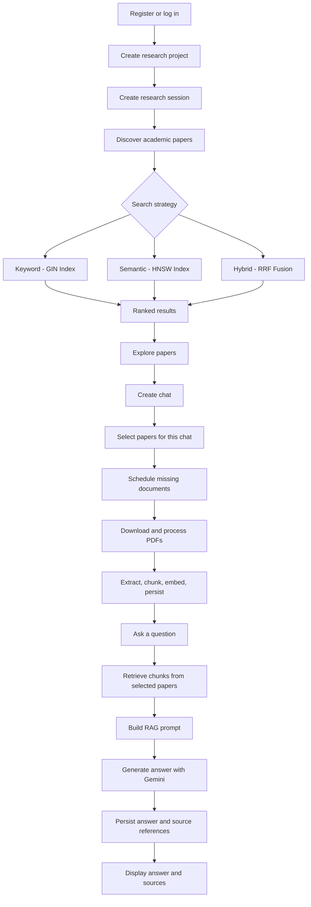
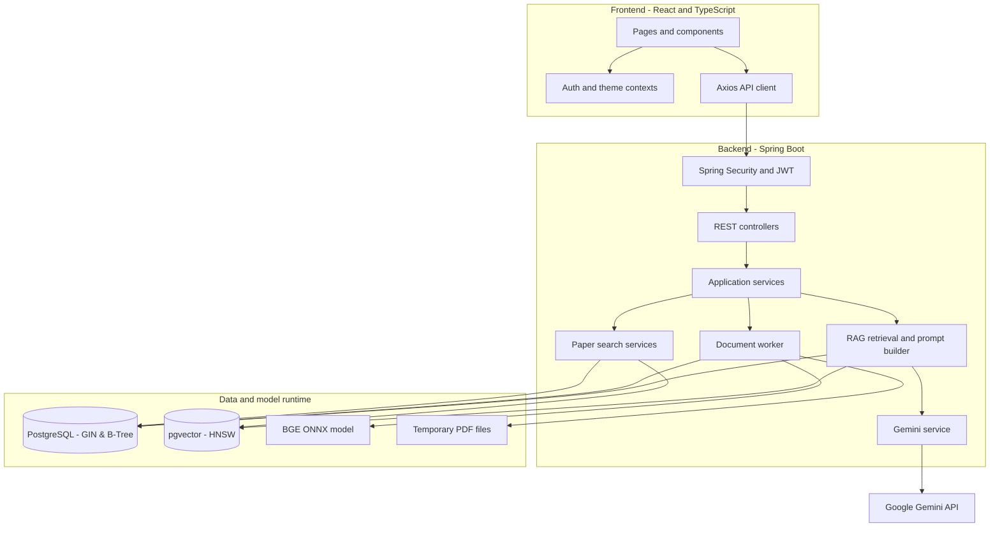
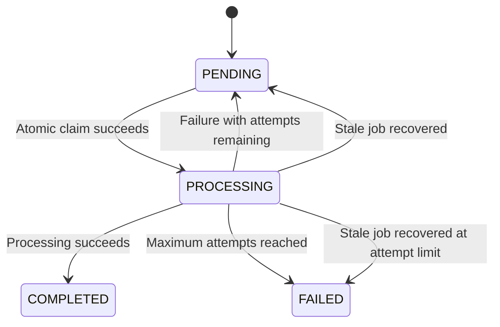
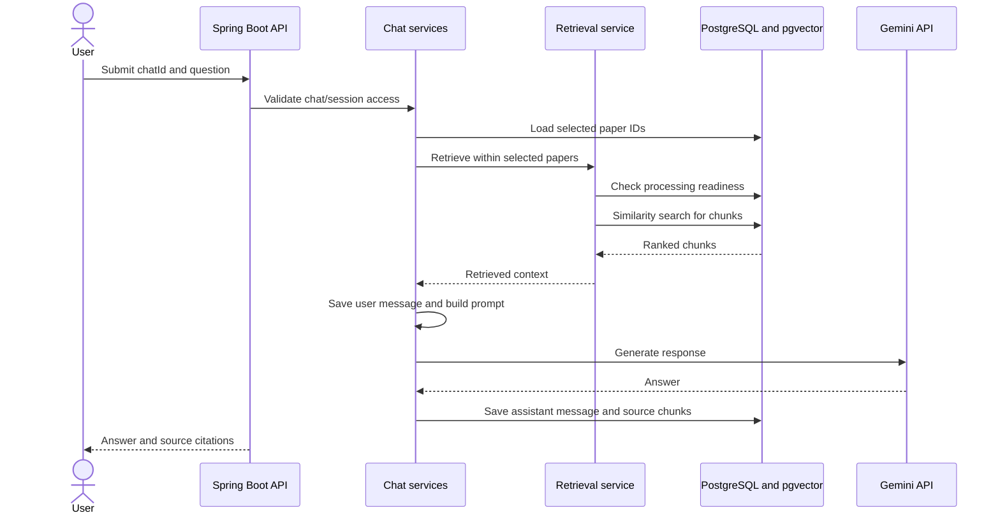
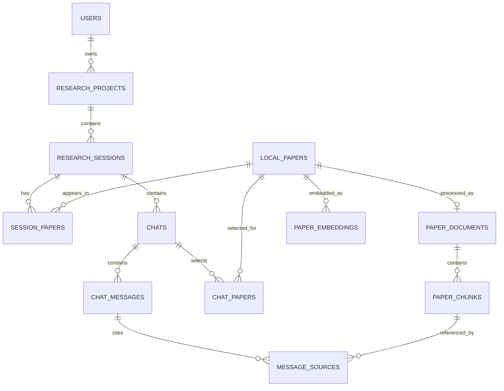
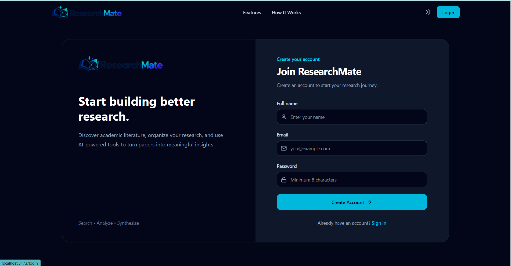
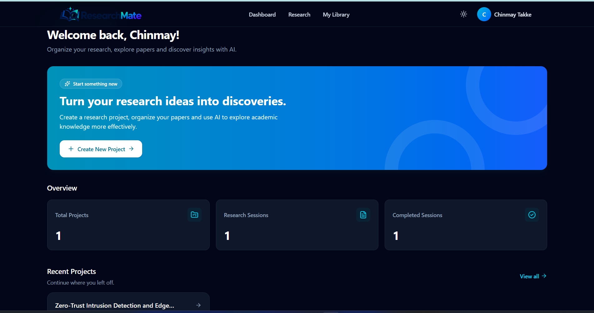
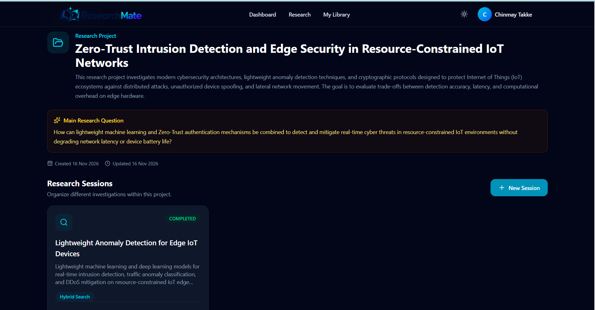
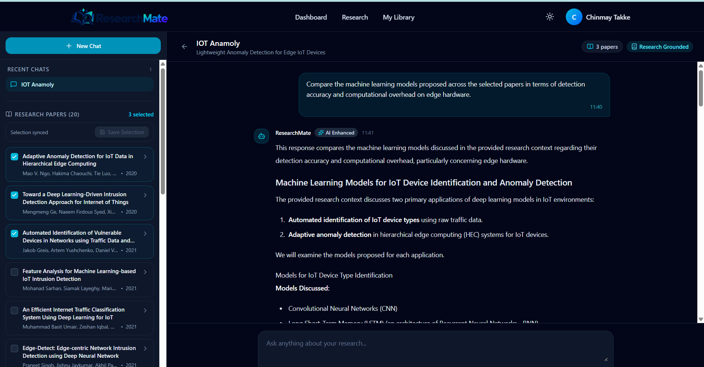
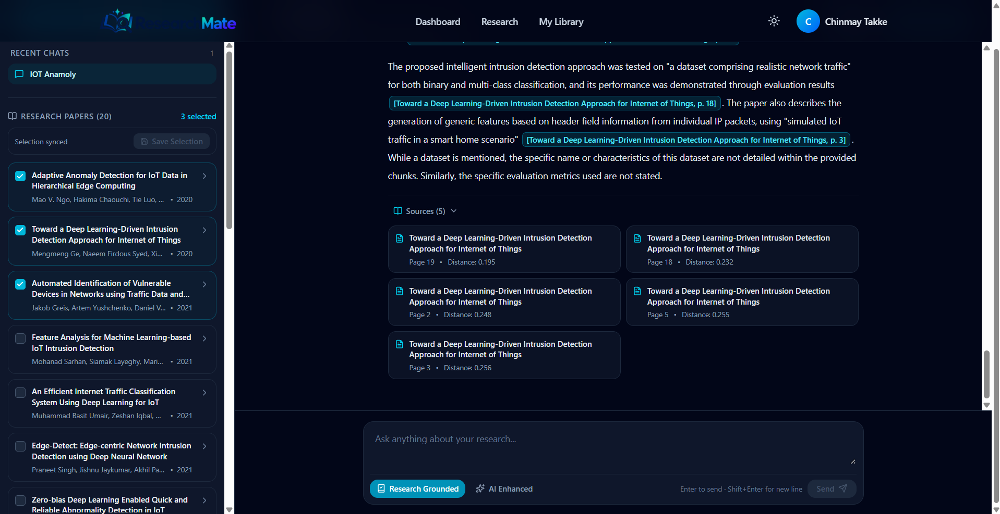

# ResearchMate

> An AI-powered academic research workspace for discovering papers,
> organizing research, and asking questions grounded in selected
> academic literature.

ResearchMate combines academic paper discovery, asynchronous PDF
processing, vector-based retrieval, and conversational AI. Users create
research projects, organize work into sessions, discover papers, select
papers independently for each chat, and receive AI-generated answers
with references to retrieved paper chunks.

## Table of Contents

-   [Overview](#overview)
-   [Features](#features)
-   [Application Workflow](#application-workflow)
-   [Architecture](#architecture)
-   [Technology Stack](#technology-stack)
-   [Paper Discovery and Search](#paper-discovery-and-search)
-   [Performance Benchmarks & Indexing](#performance-benchmarks--indexing)
-   [PDF Processing Pipeline](#pdf-processing-pipeline)
-   [Embedding and Vector Retrieval](#embedding-and-vector-retrieval)
-   [Chat-Specific RAG](#chat-specific-rag)
-   [Database Design](#database-design)
-   [API Overview](#api-overview)
-   [Frontend Structure](#frontend-structure)
-   [Security and Reliability](#security-and-reliability)
-   [Getting Started](#getting-started)
-   [Configuration](#configuration)
-   [Current Project Status and Future Improvements](#current-project-status-and-future-improvements)
-   [Screenshots](#screenshots)

## Overview

ResearchMate is a full-stack academic research assistant. It maintains a
local collection of approximately **200,000 academic paper metadata
records**, sourced from the Hugging Face dataset
[`TabMaven/arxiv-raw`](https://huggingface.co/datasets/TabMaven/arxiv-raw/tree/main).
The downloaded metadata is filtered to focus on areas including
Information Technology, Artificial Intelligence, Machine Learning,
Cybersecurity, Internet of Things (IoT), and Blockchain.

Users can search the collection using keyword, semantic, or hybrid
search. Selected papers can be processed asynchronously: PDFs are
downloaded from approved arXiv hosts, text is extracted page by page,
divided into overlapping chunks, embedded using BGE-small-en-v1.5, and
stored in PostgreSQL with pgvector. Chat-specific retrieval supplies
relevant chunks to Gemini for answer generation.

### Core concepts

1.  **Research project** — a broader research topic or area.
2.  **Research session** — a paper-discovery activity within a
    project.
3.  **Chat** — a conversation within a session with its own
    independently selected papers.

This separation allows different chats in the same session to work with
different paper collections.

## Features

-   User registration and login with JWT-based authentication.
-   Create, view, update, and delete research projects.
-   Create and manage research sessions.
-   Search ~200,000 academic metadata records using keyword (GIN full-text),
    semantic (HNSW vector), and hybrid (Reciprocal Rank Fusion) strategies.
-   Filter keyword results by category and publication date.
-   Sort results by relevance, newest, or oldest.
-   Retrieve up to 20 papers for a research session.
-   Process paper PDFs asynchronously with atomic job claiming and retry recovery.
-   Extract PDF text page by page and preserve page numbers.
-   Generate 384-dimensional BGE embeddings locally using ONNX Runtime.
-   Store chunk embeddings in PostgreSQL with pgvector.
-   Create multiple chats within a research session with a ChatGPT-style workspace.
-   Maintain paper selection independently for each chat.
-   Generate Gemini answers in `RESEARCH_GROUNDED` and `AI_ENHANCED`
    modes.
-   Associate assistant messages with retrieved source chunks and inline paper citations.

## Application Workflow



**Selection distinction:** `SessionPaper` represents session-level paper
results/selection; `ChatPaper` represents papers selected for an
individual chat; `MessageSource` represents chunks used for a particular
assistant response. These are different relationships.

## Architecture



### Backend module responsibilities

| Module | Responsibility |
| :--- | :--- |
| `auth` | Registration and login |
| `security` | JWT authentication and request security |
| `user` | User entity and persistence |
| `project` | Research project management |
| `session` | Research session and workspace management |
| `localpaper` | Metadata import, paper embeddings, and search |
| `sessionpaper` | Session paper retrieval, selection, and RAG retrieval |
| `paperdocument` | PDF download, extraction, chunking, persistence, and worker |
| `chat` | Chat management, history, selected papers, and message sources |
| `ai` | Prompt construction and Gemini answer generation |
| `paper` | Research-paper functionality |
| `mcp` | Academic paper provider/model abstractions and related integration code |

## Technology Stack

### Frontend

| Technology | Purpose |
| :--- | :--- |
| React 19 | User interface |
| TypeScript 6 | Static typing |
| Vite 8 | Development server and build tooling |
| Tailwind CSS v4 | Styling |
| React Router v7 | Client-side routing |
| Axios | HTTP communication |
| Framer Motion | UI animations |
| Lucide React | Icons |
| React Toastify | Toast notifications |
| `react-markdown` & `remark-gfm` | Rich Markdown rendering and inline citation pills |

### Backend

| Technology | Purpose |
| :--- | :--- |
| Java 21 | Backend language |
| Spring Boot 4.1.0 | Application framework |
| Spring Security | Request security |
| JWT | Token-based authentication |
| Spring Data JPA / Hibernate | ORM and persistence |
| PostgreSQL 18.3 | Relational database & GIN full-text search |
| pgvector 0.8.6 | Vector storage and HNSW cosine similarity search |
| Apache PDFBox | PDF text extraction |
| ONNX Runtime | Local model inference |
| DJL Hugging Face Tokenizers | Tokenization |
| Google GenAI Java SDK 1.79.0 | Gemini integration |
| Gemini 2.5 Flash | Answer generation |

### Embedding model

-   Model: `BAAI/bge-small-en-v1.5`
-   Dimension: 384
-   Runtime: ONNX Runtime
-   Tokenizer: Hugging Face tokenizer JSON
-   Maximum tokenized sequence length: 512
-   Pooling: First-token/CLS representation (`lastHiddenState[0][0]`)
-   Normalization: L2 normalization

## Paper Discovery and Search

### Metadata ingestion

The local metadata collection is based on the Hugging Face dataset
[`TabMaven/arxiv-raw`](https://huggingface.co/datasets/TabMaven/arxiv-raw/tree/main).
Metadata is downloaded and filtered for the technical subject areas
listed in the Overview. Approximately **200,000** records are maintained in
`local_papers` alongside 200,000 384-dimensional vector embeddings in `paper_embeddings`.

The importer classes are `LocalPaperImportRunner` and
`LocalPaperImportService`.

### Keyword search

Keyword search uses PostgreSQL full-text search accelerated by a **GIN index** (`idx_local_papers_fulltext`) on `local_papers(search_vector)`:

-   `websearch_to_tsquery('english', :query)` parses the search query.
-   `search_vector @@ query` matches terms via the GIN inverted index.
-   `ts_rank(..., 32)` calculates relevance.
-   Title relevance receives an additional multiplier of `2.0`.
-   `ts_headline()` generates highlighted title and abstract fragments.

The search supports category and publication-date filters, plus
relevance/newest/oldest sorting.

### Semantic search

The query is embedded locally into a 384-dimensional vector using `BGE-small-en-v1.5` via ONNX Runtime. PostgreSQL compares it to the 200,000 stored paper vectors using pgvector's cosine-distance operator accelerated by an **HNSW index** (`idx_paper_embeddings_hnsw` with `vector_cosine_ops`, `m=16`):

```sql
embedding <=> CAST(:queryEmbedding AS vector)
```

Similarity is calculated as:

```text
similarityScore = 1.0 - cosineDistance
```

### Hybrid search

Hybrid search retrieves up to 1,000 semantic candidates and up to 1,000
keyword candidates, combines their paper IDs with `UNION`, ranks each
candidate list, and applies Reciprocal Rank Fusion (RRF).

The implementation uses RRF constant **60**, with semantic rank weighted
at **60%** and keyword rank weighted at **40%**:

$$\text{HybridScore}(d) = 0.4\left(\frac{60}{60 + \text{keywordRank}(d)}\right) + 0.6\left(\frac{60}{60 + \text{semanticRank}(d)}\right)$$

A missing rank contributes zero. The session retrieval service requests
the first **20** results and persists them as `SessionPaper` records.

| Search parameter | Value |
| :--- | :--- |
| Semantic candidates in hybrid search | 1,000 |
| Keyword candidates in hybrid search | 1,000 |
| RRF constant | 60 |
| Semantic weight | 0.6 |
| Keyword weight | 0.4 |
| Papers retrieved per session | 20 |

## Performance Benchmarks & Indexing

### Database Indexes Verified (`pg_indexes`)

| Table | Index Name | Type | Indexed Column(s) | Purpose |
| :--- | :--- | :--- | :--- | :--- |
| `local_papers` | `idx_local_papers_fulltext` | `GIN` | `search_vector` | Accelerated full-text keyword search across ~200k papers |
| `paper_embeddings` | `idx_paper_embeddings_hnsw` | `HNSW` (`vector_cosine_ops`, `m=16`) | `embedding` | Approximate nearest-neighbor cosine similarity search across 200k 384-d vectors |
| `local_papers` | `uk_local_papers_source_external_id` | `B-Tree` (Unique) | `(source, external_id)` | Duplicate prevention & fast external ID lookups |
| `session_papers` | `uk_session_paper` | `B-Tree` (Unique) | `(session_id, paper_id)` | Fast session workspace paper retrieval |
| `chat_papers` | `uk_chat_paper` | `B-Tree` (Unique) | `(chat_id, paper_id)` | Fast chat-scoped paper selection lookup |
| `paper_chunks` | `uk_paper_chunks_document_index` | `B-Tree` (Unique) | `(paper_document_id, chunk_index)` | Ordered chunk retrieval per document |

### Query Execution & API Latency Benchmarks

Benchmarked locally across **200,000 paper records** using PostgreSQL `EXPLAIN (ANALYZE, BUFFERS)` and Postman Collection Runner (**20 iterations / 60 total requests**, `201 Created`, 0% error rate):

| Benchmark Metric | Strategy / Operation | Measured Result | Notes |
| :--- | :--- | :--- | :--- |
| **End-to-End API Latency** | Keyword Search (`POST /sessions`) | **~50–57 ms** | Includes JWT auth, GIN index scan, ranking & persistence |
| **End-to-End API Latency** | Hybrid Search (`POST /sessions`) | **~143–146 ms** | Combines 1,000 semantic + 1,000 keyword candidates with RRF |
| **End-to-End API Latency** | Semantic Search (`POST /sessions`) | **~399–473 ms** | Includes local ONNX BGE-small inference + HNSW cosine scan |
| **Overall Benchmark Avg.** | All 3 Strategies (60 requests) | **173 ms** | Measured across 20 automated Postman Runner iterations |
| **PostgreSQL Vector Scan** | `Index Scan using idx_paper_embeddings_hnsw` | **265.36 ms** (cold cache) | Confirmed HNSW index usage (`shared hit=90 read=656`), avoiding full table `Seq Scan` |

## PDF Processing Pipeline

Paper documents are processed asynchronously by
`PaperDocumentWorkerService`.

### Processing lifecycle



### Scheduling and polling

`PaperDocumentSchedulingService.scheduleIfNeeded(paperId)` verifies that
the paper exists and inserts a document record if one is absent. Its
native insert uses `ON CONFLICT (paper_id) DO NOTHING`, avoiding
duplicate document records for the same paper.

The worker is enabled through `researchmate.documents.worker-enabled`.
It polls at a configurable fixed delay, default **5,000 ms**. Each poll
attempts stale-job recovery and then selects the oldest pending
document.

### Atomic claiming and concurrency

The repository claims a document with a conditional update:

```sql
UPDATE paper_documents
SET status = 'PROCESSING',
    attempt_count = attempt_count + 1,
    started_at = CURRENT_TIMESTAMP,
    updated_at = CURRENT_TIMESTAMP,
    last_error = NULL
WHERE id = :documentId
  AND status = 'PENDING';
```

The claim succeeds only when one row is updated. Because the status
condition is part of the database update, competing claim attempts
cannot both successfully transition the same row from `PENDING` to
`PROCESSING`. The worker processes the document only when the repository
returns `1`.

### Failure handling and stale recovery

-   Maximum attempts default to **3**.
-   A processing failure returns the document to `PENDING` while
    attempts remain.
-   Once the attempt limit is reached, the document becomes `FAILED`.
-   A document is considered stale when it remains `PROCESSING` for more
    than **15 minutes**.
-   Stale jobs are returned to `PENDING` if attempts remain, otherwise
    marked `FAILED`.
-   Recovery clears `started_at` and records a diagnostic message in
    `last_error`.
-   Error messages stored from normal failures are capped at 1,000
    characters.

### PDF download safeguards

`PdfDownloadService` downloads PDFs into a configured temporary
directory.

| Safeguard | Implementation |
| :--- | :--- |
| Allowed hosts | `arxiv.org`, `export.arxiv.org` |
| Protocol | HTTPS only |
| Connection timeout | 10 seconds |
| Read timeout | 30 seconds |
| Maximum redirects | 3 |
| Maximum file size | Configurable |
| Signature validation | Checks `%PDF-` |
| Temporary-file cleanup | Deletes failed downloads and removes files after processing |

The downloader also validates the URL, rejects user-info and unsupported
ports, checks resolved IP addresses against non-public address ranges,
validates HTTP status and response content type, and enforces the size
limit both from the content-length header and while streaming.

### PDF extraction

`PdfTextExtractionService` uses Apache PDFBox to extract one page at a
time:

-   Preserves the source page number.
-   Uses positional text sorting.
-   Removes NULL characters.
-   Rejects empty PDFs.
-   Enforces a configurable maximum page count, default **500**.
-   Fails if no extractable text is found.

### Chunking

`PaperChunkingService` divides each extracted page into chunks:

| Parameter | Value |
| :--- | :--- |
| Chunk size | 1,000 characters |
| Overlap | 150 characters |
| Boundary handling | Prefers a nearby word boundary |
| Page metadata | Preserved on each chunk |
| Chunk index | Sequential within the processed document |

### Persistence

Chunks are stored in `paper_chunks` and associated with a
`paper_documents` record. The table includes chunk content, index, page
number, optional section title, and embedding. Downloaded PDFs are
temporary and are deleted by the worker after processing.

## Embedding and Vector Retrieval

`BgeEmbeddingService` loads:

```text
models/bge-small-en-v1.5/model.onnx
models/bge-small-en-v1.5/tokenizer.json
```

The service tokenizes text with truncation and a maximum length of 512,
creates ONNX tensors for `input_ids`, `attention_mask`, and
`token_type_ids`, and runs the model.

The implementation:
1. Reads the last hidden-state output.
2. Uses the first token representation (`lastHiddenState[0][0]`).
3. Verifies the output dimension is 384.
4. Applies L2 normalization.
5. Rejects a zero-magnitude vector.

Chunk retrieval validates the query, selected paper IDs, and `topK`
(1–50), generates the query vector, and searches chunks using cosine
distance:

```sql
pc.embedding <=> CAST(:queryEmbedding AS vector)
```

Chat-restricted retrieval additionally filters by selected paper IDs and
requires document status `COMPLETED` and a non-null chunk embedding.

## Chat-Specific RAG

Paper selection is maintained independently for each chat. For example,
one chat may select papers 1, 2, and 3, while another chat in the same
session selects papers 4 and 5.

The `chat_papers` table represents chat-level selection. Before
retrieval, the application checks document readiness and schedules
missing documents where necessary. If no papers are selected, retrieval
returns an informative validation error.



### Message source traceability

`MessageSource` connects an assistant message to the exact chunks used
for that response. This is distinct from `ChatPaper`, which stores the
papers selected for the chat.

## Answer Generation

ResearchMate integrates Gemini through
`com.google.genai:google-genai:1.79.0`.

- Model: `gemini-2.5-flash`
- API key environment variable: `GEMINI_KEY`
- Prompt construction: `RagPromptBuilder`
- Answer modes: `RESEARCH_GROUNDED` and `AI_ENHANCED`

The answer service:
1. Validates chat access within the session.
2. Retrieves chunks restricted to the chat's selected papers.
3. Saves the user message.
4. Builds a prompt from the question, answer mode, and retrieved chunks.
5. Calls Gemini.
6. Saves the assistant response and source-chunk associations.
7. Returns the answer and source citation metadata.

## Database Design

ResearchMate uses PostgreSQL for relational data and pgvector for vector
columns and similarity queries.

### Main tables

| Table | Responsibility |
| :--- | :--- |
| `users` | User accounts |
| `research_projects` | User-owned projects |
| `research_sessions` | Research activities within projects |
| `local_papers` | Imported academic metadata and GIN-indexed `tsvector` |
| `paper_embeddings` | HNSW-indexed 384-d paper-level vectors for semantic discovery |
| `session_papers` | Session paper results, ranking scores, and selection state |
| `paper_documents` | PDF processing status, attempts, and timestamps |
| `paper_chunks` | Extracted chunks and chunk embeddings |
| `chats` | Conversations within sessions |
| `chat_papers` | Papers selected for an individual chat |
| `chat_messages` | User and assistant messages |
| `message_sources` | Chunk references associated with assistant messages |

### Entity relationship diagram



### Important distinctions

-   `local_papers` contains paper metadata and the GIN-indexed `search_vector`.
-   `paper_embeddings` contains HNSW-indexed paper-level vectors for semantic discovery.
-   `paper_chunks` contains chunk-level vectors for RAG.
-   `session_papers` represents session-level paper results/selection.
-   `chat_papers` represents chat-specific paper selection.
-   `message_sources` represents chunks used for an individual assistant response.

### Schema management

The project uses Hibernate/JPA for ORM and schema management alongside SQL index definitions for GIN full-text search and pgvector HNSW indexing.

## API Overview

### Authentication

| Method | Endpoint | Purpose |
| :--- | :--- | :--- |
| POST | `/api/auth/register` | Register a user |
| POST | `/api/auth/login` | Authenticate a user |

### Projects

| Method | Endpoint | Purpose |
| :--- | :--- | :--- |
| POST | `/api/projects` | Create a project |
| GET | `/api/projects` | List projects |
| GET | `/api/projects/{projectId}` | Get project details |
| PUT | `/api/projects/{projectId}` | Update a project |
| DELETE | `/api/projects/{projectId}` | Delete a project |

### Sessions and workspace

| Method | Endpoint | Purpose |
| :--- | :--- | :--- |
| POST | `/api/projects/{projectId}/sessions` | Create a research session & execute paper search |
| GET | `/api/projects/{projectId}/sessions` | List sessions in a project |
| GET | `/api/projects/{projectId}/sessions/{sessionId}/workspace` | Retrieve session workspace |
| PUT | `/api/sessions/{sessionId}/papers/selection` | Update session-level paper selection |
| POST | `/api/sessions/{sessionId}/rag/retrieve` | Retrieve relevant chunks for a session-level RAG query |
| POST | `/api/sessions/{sessionId}/rag/answer` | Generate an answer using a chat in the session |

### Chats

| Method | Endpoint | Purpose |
| :--- | :--- | :--- |
| POST | `/api/sessions/{sessionId}/chats` | Create a chat |
| GET | `/api/sessions/{sessionId}/chats` | List chats in a session |
| GET | `/api/chats/{chatId}/messages` | Retrieve chat messages |
| PUT | `/api/chats/{chatId}/papers/selection` | Replace selected papers for a chat |
| GET | `/api/chats/{chatId}/papers/selection` | Retrieve selected papers for a chat |

### Chat paper selection request

```json
{
  "paperIds": ["paper-uuid-1", "paper-uuid-2"]
}
```

An empty array clears the chat's paper selection.

### RAG answer request

```json
{
  "chatId": "chat-uuid",
  "question": "What are the main contributions of these papers?",
  "answerMode": "RESEARCH_GROUNDED",
  "topK": 5
}
```

The answer request accepts a non-empty question of up to 2,000
characters. `topK` defaults to 5 and is constrained to 1–20 at the
request DTO level. The lower-level chunk retrieval service accepts
1–50.

The response contains `answer`, `answerMode`, and `sources`. A source
can include `paperId`, `chunkId`, `pageNumber`, `sectionTitle`, and
`distance`.

## Frontend Structure

Known routes:

| Route | Page |
| :--- | :--- |
| `/` | Landing page |
| `/login` | Login |
| `/register` | Registration |
| `/dashboard` | Live user analytics & recent projects dashboard |
| `/research/new` | Create research project |
| `/research` | Research/project listing |
| `/research/:projectId` | Project workspace |
| `/research/:projectId/sessions/:sessionId` | ChatGPT-style split-pane session workspace |

The frontend is organized as follows:

| Directory | Responsibility |
| :--- | :--- |
| `components/auth` | Protected and public-only route guards |
| `components/chat` | Chat sidebar, expandable paper items, chat list, input, messages, sources, and new-chat dialog |
| `components/landing` | Landing page sections |
| `components/layout` | Shared navigation |
| `components/session` | Session header and paper explorer |
| `context` | Authentication and theme contexts |
| `lib` | Axios client and toast helpers |
| `pages` | Route-level pages |
| `services` | Authentication, chat, and research API functions |
| `types` | Shared TypeScript types |

`src/lib/api.ts` centralizes Axios communication and includes a JWT
interceptor. Authentication and theme state are managed through React
context.

## Security and Reliability

Implementation-level safeguards include:

-   JWT-based authentication and Spring Security.
-   Protected frontend routes.
-   Chat/session access validation before answer generation.
-   Validation that chat-selected papers belong to the relevant session.
-   Atomic conditional updates for document claiming.
-   Processing attempt limits and stale-job recovery.
-   PDF HTTPS enforcement and host allowlisting.
-   URL and resolved-address validation.
-   PDF response, signature, redirect, timeout, and size checks.
-   Temporary PDF cleanup.
-   Validation of empty queries, paper selections, and retrieval limits.
-   Global backend exception handling.

## Getting Started

ResearchMate is currently a local-development project. It is not
deployed and does not use Docker or Docker Compose.

### Prerequisites

-   Java 21
-   Node.js and npm
-   PostgreSQL 18+ with `pgvector` extension (`v0.8.6+`)
-   Google Gemini API key
-   BGE-small-en-v1.5 ONNX model and tokenizer files

### 1. Clone the repositories

```bash
git clone <frontend-repository-url>
git clone <backend-repository-url>
```

### 2. Prepare PostgreSQL

Create a database and enable `pgvector`:

```sql
CREATE DATABASE researchmate;
\c researchmate
CREATE EXTENSION IF NOT EXISTS vector;
```

Ensure the GIN and HNSW indexes are created on `local_papers` and `paper_embeddings`:

```sql
CREATE INDEX IF NOT EXISTS idx_local_papers_fulltext
ON public.local_papers USING gin (search_vector);

CREATE INDEX IF NOT EXISTS idx_paper_embeddings_hnsw
ON public.paper_embeddings USING hnsw (embedding vector_cosine_ops) WITH (m = 16);
```

### 3. Add the embedding model files

Place the model files at the paths expected by `BgeEmbeddingService`:

```text
models/
└── bge-small-en-v1.5/
    ├── model.onnx
    └── tokenizer.json
```

### 4. Configure the backend

Set the Gemini key, datasource credentials, and document-processing
properties. See [Configuration](#configuration).

### 5. Start the backend

Start the Spring Boot application on port `8080`.

### 6. Start the frontend

From the frontend directory:

```bash
npm install
npm run dev
```

## Configuration

| Setting | Purpose |
| :--- | :--- |
| `GEMINI_KEY` | Google Gemini API key |
| `researchmate.documents.worker-enabled` | Enables/disables the document worker |
| `researchmate.documents.poll-delay-ms` | Polling delay; default 5,000 ms |
| `researchmate.documents.max-attempts` | Maximum attempts; default 3 |
| `researchmate.documents.temp-directory` | Temporary PDF directory |
| `researchmate.documents.max-pdf-size-bytes` | Maximum PDF size |
| `researchmate.documents.max-pages` | Maximum page count; default 500 |

Example properties:

```properties
# Provide GEMINI_KEY through the environment.

researchmate.documents.worker-enabled=true
researchmate.documents.poll-delay-ms=5000
researchmate.documents.max-attempts=3
researchmate.documents.temp-directory=<temporary-directory>
researchmate.documents.max-pdf-size-bytes=<maximum-size-in-bytes>
researchmate.documents.max-pages=500
```

## Current Project Status and Future Improvements

Potential future enhancements:

-   Automated unit, integration, and end-to-end tests.
-   CI workflows for builds, tests, and static analysis.
-   OpenAPI/Swagger documentation.
-   Docker Compose for reproducible local development.
-   Cloud deployment for frontend and backend.
-   OCR support for scanned/image-only PDFs.
-   Section-title extraction and section-aware chunking.
-   Monitoring for queue depth, processing duration, retries, and failures.

## Screenshots

### Landing Page


### Sign Up


### Dashboard


### Project Workspace


### Session & Chat Workspace


### Session Workspace — Answer & Citations


## License

Add the project's chosen license before publishing or distributing the
repository.